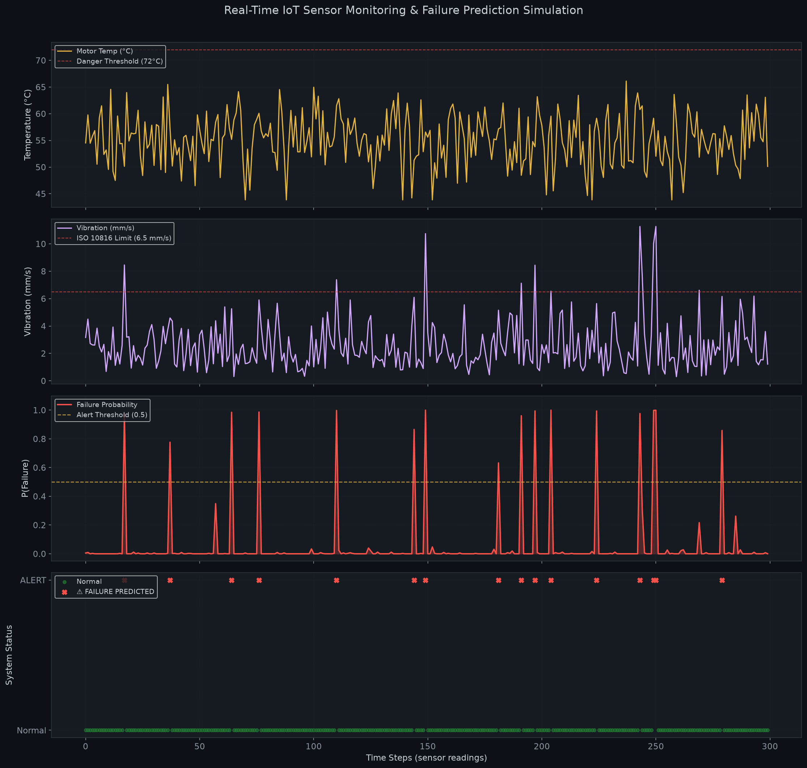
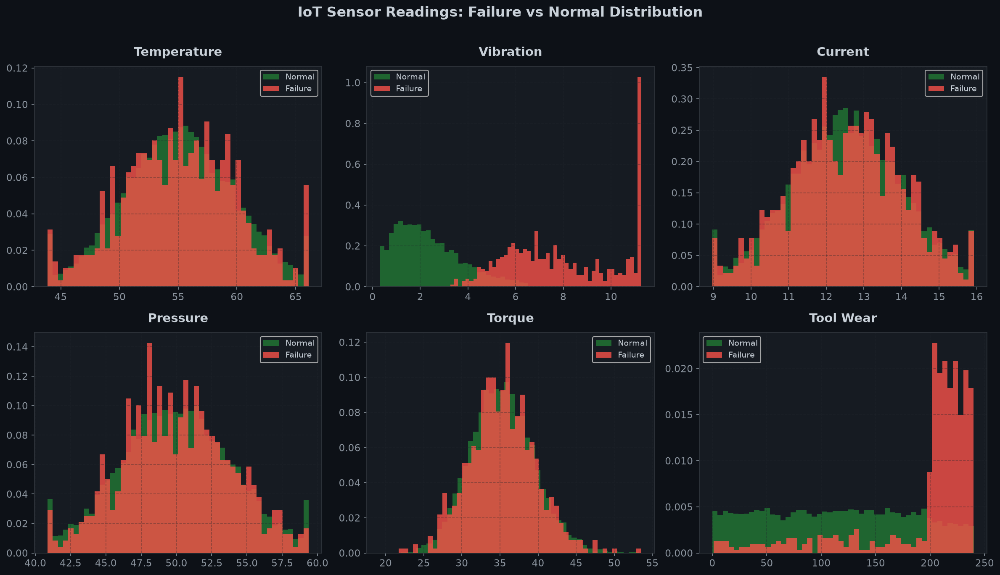
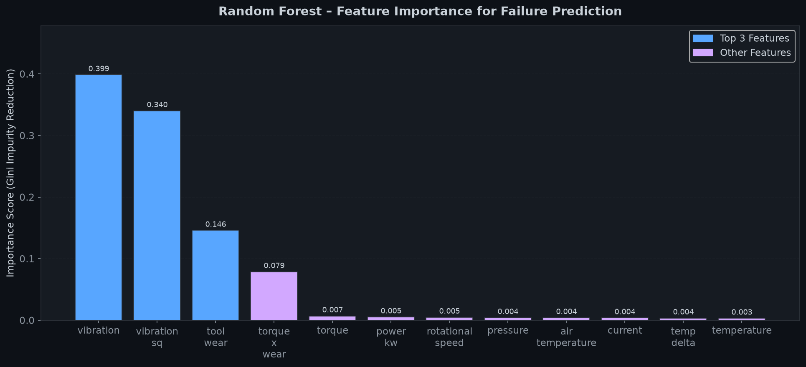
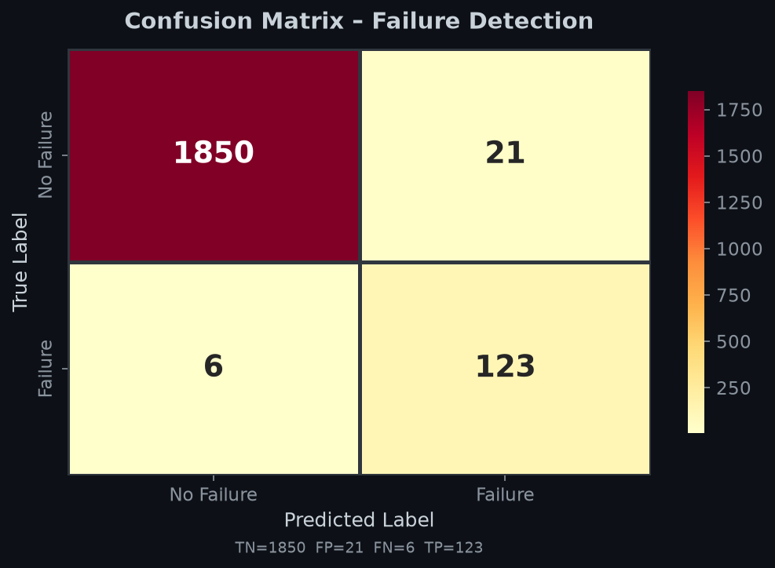
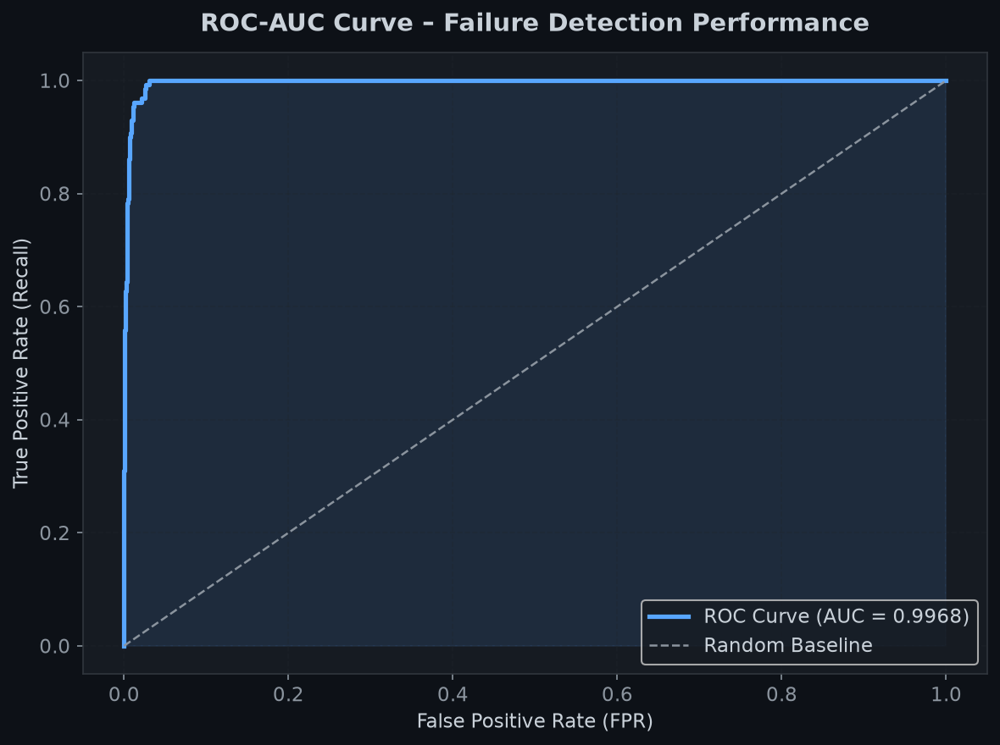

<h1 align="center">🏭 AI-Powered Predictive Maintenance for IoT Devices</h1>

<p align="center">
  
</p>

<p align="center">
  
  
  
  
  
  
</p>

<p align="center">
  <b>An industry-grade AI system that predicts IoT machine failures before they happen — using sensor data, Random Forest ML, Flask API, and live simulation.</b>
</p>

---

## 📌 Overview

This project builds a complete **end-to-end predictive maintenance pipeline** that mirrors what companies like **Siemens, GE, Bosch, IBM Watson IoT, and Tesla** use in production.

Since physical IoT hardware (Raspberry Pi, sensors) is not required, the system uses a **physics-based virtual sensor simulation** that generates realistic industrial telemetry data — making this 100% runnable on any laptop.

---

## 🔴 Problem Statement

> Traditional maintenance is **reactive** — machines are fixed *after* they fail.  
> This causes:
> - 🔴 Unplanned downtime costing **$50,000–$250,000/hour** in manufacturing
> - 🔴 Worker safety hazards from sudden equipment failures  
> - 🔴 Supply chain disruptions  
> - 🔴 Asset damage that worsens with delayed repairs

**Predictive Maintenance solves this** by monitoring sensor signals continuously and alerting maintenance teams *before* failure occurs.

---

## 🏭 Industry Relevance

| Company | Use Case |
|---|---|
| **Siemens** | Factory motor & pump health monitoring |
| **General Electric** | Jet engine RUL prediction |
| **Tesla** | Battery thermal management |
| **McDonald's** | Ice cream machine failure prediction (43,000+ locations) |
| **Air France-KLM** | Aircraft maintenance prediction with Google Cloud |
| **U.S. Navy** | 10,000 sensor readings/second on USS Fitzgerald |

**Market:** $7.85B (2022) → $60.13B (2030) at **29.5% CAGR**

---

## 🛠️ Tech Stack

| Component | Technology |
|---|---|
| Language | Python 3.10+ |
| ML Model | `scikit-learn` Random Forest Classifier |
| Data Processing | `pandas`, `numpy` |
| Visualization | `matplotlib`, `seaborn` |
| API Deployment | `Flask` REST API |
| Model Persistence | `joblib` |
| Dataset | Synthetic physics-based IoT simulation |

---

## 📊 Dataset

**Synthetic industrial IoT sensor telemetry** (10,000 records) modeled after:
- UCI AI4I 2020 Predictive Maintenance Dataset
- NASA C-MAPSS turbofan engine degradation data

| Feature | Description | Normal Range |
|---|---|---|
| `temperature` | Motor casing temp (°C) | 40 – 70°C |
| `vibration` | Velocity (mm/s, ISO 10816) | < 4.5 mm/s |
| `current` | Motor current draw (A) | 10 – 15A |
| `rotational_speed` | Shaft speed (RPM) | 1350 – 1700 |
| `torque` | Mechanical torque (Nm) | 28 – 48 Nm |
| `pressure` | Coolant line pressure (PSI) | 45 – 60 PSI |
| `tool_wear` | Cumulative operation time (min) | 0 – 240 min |
| `failure` | **Target: 0=Normal, 1=Failure** | — |

**5 Failure Modes Simulated:**
- 🔥 Heat Dissipation Failure
- ⚙️ Tool Wear Failure  
- ⚡ Power Overload Failure
- 💪 Overstrain Failure
- 📳 Vibration Imbalance

---

## 🏗️ Architecture

```
┌──────────────────────────────────────────────────────────┐
│               IoT SENSOR DATA LAYER                      │
│  Temp │ Vibration │ Current │ RPM │ Torque │ Pressure    │
└───────────────────────┬──────────────────────────────────┘
                        │
                        ▼
┌──────────────────────────────────────────────────────────┐
│              PREPROCESSING PIPELINE                      │
│  src/preprocess.py                                       │
│  • Missing value handling                                │
│  • IQR outlier clipping                                  │
│  • Feature Engineering (temp_delta, power_kw, etc.)     │
│  • StandardScaler normalization                          │
└───────────────────────┬──────────────────────────────────┘
                        │
                        ▼
┌──────────────────────────────────────────────────────────┐
│              RANDOM FOREST CLASSIFIER                    │
│  src/train.py                                            │
│  • 300 decision trees                                    │
│  • class_weight="balanced" for 93/7 imbalance            │
│  • Trained on 8,000 samples                              │
└───────────────────────┬──────────────────────────────────┘
                        │ P(failure) = 0.0 – 1.0
                        ▼
┌──────────────────────────────────────────────────────────┐
│               ALERT / DECISION ENGINE                    │
│  P ≥ 0.80 → CRITICAL  │  P ≥ 0.50 → HIGH RISK           │
│  P ≥ 0.25 → MODERATE  │  P < 0.25 → NORMAL              │
└────────────────┬──────────────────┬──────────────────────┘
                 │                  │
                 ▼                  ▼
         Flask REST API      Visualizations
         app.py              src/visualize.py
         /predict endpoint   7 charts in images/
```

---

## 📁 Folder Structure

```
AI-Predictive-Maintenance-IoT/
│
├── data/
│   ├── generate_dataset.py    # Physics-based IoT data generator
│   └── iot_sensor_data.csv    # 10,000 synthetic sensor records
│
├── src/
│   ├── __init__.py
│   ├── preprocess.py          # Data cleaning + feature engineering
│   ├── train.py               # Model training + evaluation
│   ├── predict.py             # Single-sample inference
│   ├── simulate.py            # Live IoT streaming simulation
│   └── visualize.py           # 7 visualization charts
│
├── models/
│   ├── predictive_maintenance_model.pkl  # Trained model
│   └── scaler.pkl                        # Feature scaler
│
├── outputs/
│   ├── predictions.csv        # Test set predictions
│   └── model_metrics.json     # All evaluation metrics
│
├── images/
│   ├── 01_sensor_distributions.png
│   ├── 02_correlation_heatmap.png
│   ├── 03_feature_importance.png
│   ├── 04_confusion_matrix.png
│   ├── 05_roc_auc_curve.png
│   ├── 06_timeseries_prediction.png
│   └── 07_failure_mode_breakdown.png
│
├── notebooks/
│   └── EDA_and_Analysis.py    # Exploratory data analysis
│
├── docs/
│   ├── PROJECT_EXPLANATION.md
│   └── GITHUB_GUIDE.md
│
├── app.py                     # Flask REST API
├── main.py                    # Master pipeline (run this first)
├── requirements.txt
└── .gitignore
```

---

## ⚙️ Installation

### Prerequisites
- Python 3.10+
- pip

### Setup (macOS / Linux)
```bash
# 1. Clone the repository
git clone https://github.com/YOUR_USERNAME/AI-Predictive-Maintenance-IoT.git
cd AI-Predictive-Maintenance-IoT

# 2. Create virtual environment
python3 -m venv .venv
source .venv/bin/activate

# 3. Install dependencies
pip install -r requirements.txt
```

### Setup (Windows)
```bash
python -m venv .venv
.venv\Scripts\activate
pip install -r requirements.txt
```

---

## 🚀 Usage

### Run Full Pipeline (recommended for first run)
```bash
python main.py
```
This will:
1. Generate dataset (if not already present)
2. Preprocess + engineer features
3. Train the Random Forest model
4. Evaluate and save metrics
5. Generate all 7 visualizations in `images/`
6. Run the live IoT simulation (30 readings)
7. Print the final performance summary

---

### Run Flask API
```bash
python app.py
```
Open browser: http://127.0.0.1:5000

**Test with curl:**
```bash
# Failing machine scenario
curl -X POST http://127.0.0.1:5000/predict \
  -H "Content-Type: application/json" \
  -d '{
    "air_temperature": 26,
    "temperature": 85,
    "vibration": 9.5,
    "current": 20,
    "rotational_speed": 1250,
    "torque": 65,
    "pressure": 40,
    "tool_wear": 220
  }'
```

**Expected Response:**
```json
{
  "prediction": 1,
  "failure_probability": 0.8266,
  "risk_level": "CRITICAL",
  "status": "Machine failure predicted!",
  "alert": true
}
```

---

## 📈 Results

| Metric | Score |
|---|---|
| **Accuracy** | **98.65%** |
| **Precision** | **85.42%** |
| **Recall** | **95.35%** |
| **F1-Score** | **90.11%** |
| **ROC-AUC** | **0.9968** |

> **Recall of 95.35%** is the most critical metric — it means the model catches **95 out of every 100 real failures**, minimizing dangerous missed alerts.

---

## 📸 Screenshots

<table>
  <tr>
    <td><br><center>Sensor Distributions</center></td>
    <td><br><center>Feature Importance</center></td>
  </tr>
  <tr>
    <td><br><center>Confusion Matrix</center></td>
    <td><br><center>ROC-AUC Curve</center></td>
  </tr>
  <tr>
    <td colspan="2"><br><center>Real-Time Failure Prediction Simulation</center></td>
  </tr>
</table>

---

## 🎓 Learning Outcomes

By building this project, you have demonstrated:

- ✅ **Data Engineering** — synthetic physics-based IoT data generation
- ✅ **Feature Engineering** — domain-driven features (power_kw, torque_x_wear, temp_delta)
- ✅ **ML Pipeline** — end-to-end sklearn pipeline with imbalanced data handling
- ✅ **Model Evaluation** — precision, recall, F1, ROC-AUC, confusion matrix
- ✅ **API Development** — Flask REST API with JSON input/output
- ✅ **Visualization** — 7 publication-quality dark-themed charts
- ✅ **System Thinking** — complete modular, production-ready architecture

---

## 🔮 Future Enhancements

- [ ] LSTM / Transformer model for time-series forecasting
- [ ] Real MQTT broker integration (EMQX / HiveMQ)
- [ ] Deploy Flask API to AWS EC2 / Render / Railway
- [ ] Streamlit interactive dashboard
- [ ] Docker containerization
- [ ] Integration with Grafana + InfluxDB for real-time monitoring

---

## 📜 License

MIT License — free to use, modify, and distribute.

---

<p align="center">
  <i>Built for industry-level GitHub proof | Placements | Internships | Off-campus opportunities</i><br>
  <b>Star ⭐ this repo if it helped you!</b>
</p>
